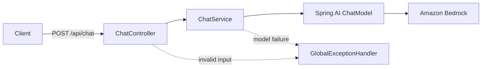

# Design: Bedrock Chat API

## Request path

`ChatController` validates `ChatRequest`. Jackson rejects unknown fields and number/boolean-to-string coercion; Bean Validation applies `@NotBlank` and `@Size`. `ChatService` builds system and user messages, calls the model, and rejects missing or blank output. `GlobalExceptionHandler` returns the stable 400/503 JSON bodies in the requirements.

Health endpoints are provided by Actuator. The contract is a static resource at `src/main/resources/static/openapi.yaml`. Neither route calls the model.

## Credentials and deployment

The application relies on the AWS SDK credential chain. `scripts/run-app.sh` exports current credentials when `AWS_PROFILE` is set; that export does not renew an expired local session.

The public `k8s/base` still contains an `envFrom` reference to `bedrock-credentials`. The private EKS deployment removes that reference, selects an IRSA-enabled service account, and supplies a projected web-identity token so role credentials can renew. Disabling the ordinary Kubernetes API token automount does not replace the token needed for IRSA.

Environment-specific IAM, Speedscale capture, tenant routing, native AWS S3 BYOC, and any sealed secrets belong in private deployment configuration. This spec contains no environment identifiers.

## Verification boundaries

| Evidence | What it establishes |
|---|---|
| `ChatApiTest` | HTTP routing, common invalid inputs, ASCII length boundaries, model message roles/user text, sanitized dependency errors, healthy probes, served contract, and removed sample routes |
| Current `assertContractResponse` helper | Property names and required nonblank strings for selected chat responses |
| OpenAPI validator in CI | Structural validity of the contract |
| Private live smoke/capture checks | Separate evidence for AWS access and the deployed capture path |

The current tests do not provide full schema conformance, Unicode boundary coverage, health-failure coverage, or live Bedrock/network retry verification. The companion spec addresses contract enforcement only.

## Working on this demo

Use this baseline as context. For a new feature, write a small feature spec with an observable before/after example, then change the contract, tests, and implementation together. Update this baseline when behavior changes. Do not rebuild existing components or add proxymock as part of reading this spec.
