# Spring Bedrock Demo

A Java 21 Spring Boot API that sends support questions to Amazon Bedrock Converse. Forked from [AWS's Spring AI Bedrock sample](https://github.com/aws-samples/sample-springai-amazonbedrock), with the interactive console, temperature examples, and RAG removed. One process, one cloud dependency, no database.

## Architecture

Example deployment and demo workflow. IRSA, capture and storage settings belong in a private overlay.

### Application architecture



### Capture and storage



### Local testing in Kiro



[Mermaid sources and rendering instructions](docs/architecture/README.md).

## Run locally

Install JDK 21 and configure AWS credentials with access to Bedrock. The application uses the AWS SDK default credential chain. When `AWS_PROFILE` is set, the launcher uses AWS CLI v2 and Python 3 to export that profile's current credentials into the JVM environment without writing them to disk.

```bash
export AWS_PROFILE=your-profile
./scripts/build-app.sh
./scripts/run-app.sh
```

Set `JAVA_HOME` to your JDK 21 installation. The API listens on port 8080. Override `PORT`, `AWS_REGION`, or `BEDROCK_MODEL_ID` as needed. The defaults are `us-east-1` and `us.anthropic.claude-sonnet-5-5`; the model must be available in your account. Each successful chat request makes a paid Bedrock call.

```bash
curl --fail http://localhost:8080/api/chat \
  -H 'Content-Type: application/json' \
  -d '{"prompt":"How do I reset my password?"}'
./scripts/smoke-test.sh
```

Successful calls return `{"response":"..."}`. Invalid requests return HTTP 400; Bedrock failures or empty model responses return HTTP 503 with `{"error":"..."}`. Requests accept only a nonblank `prompt`, up to 4000 characters. Each request is independent, with no conversation history or streaming.

## Generate a little traffic

Use Bash and curl to send a finite mix of valid chat prompts, rejected blank prompts and health checks:

```bash
./scripts/traffic-client.sh --base-url http://localhost:8080 --output /tmp/bedrock-run.json
```

The default is 30 sequential requests, two seconds apart, with at most 16 paid chat calls. It checks HTTP status codes, stops on an unexpected status or connection error, and never retries. Use `--count` and `--interval` to change the bounds. Health checks and rejected blank prompts do not call Bedrock. The JSON summary records the UTC capture window and run ID; every request carries that ID in `X-Demo-Run`. Keep capture and snapshot configuration in your private environment.

## API contract and CI

The checked-in contract is [openapi.yaml](src/main/resources/static/openapi.yaml), served at [http://localhost:8080/openapi.yaml](http://localhost:8080/openapi.yaml). It documents requests, response fields, validation errors, dependency failures, and application health. Review contract changes with application changes; use a pinned revision when measuring schema coverage.

`./mvnw verify` runs the HTTP integration tests with a test-only replacement for the model. No AWS credentials or cloud calls are needed in CI. The runtime always uses Bedrock. GitHub Actions also validates the OpenAPI document, renders the Kubernetes overlay, and builds the container. Deployment is manual.

## Kubernetes

The reusable [Kubernetes base](k8s/base) provides one replica, a ClusterIP service, resource limits, a non-root container, and health probes. Supply your image and a `bedrock-credentials` Secret from a private deployment overlay. The application supports standard AWS environment credentials; cluster-specific credentials, capture configuration, storage settings, and endpoints belong outside this public repository.

Health checks do not call Bedrock. The API has no authentication or public ingress. Access it through port-forwarding unless your private deployment provides an authenticated entry point. The starting application contains no recorded traffic, replay pipeline, or repository-specific testing skill.

## License

[MIT-0](LICENSE), retaining the upstream AWS license.
